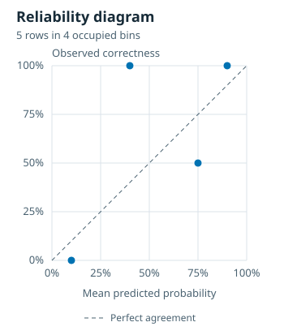

# Confidence-Aware Annotation Toolkit

[](https://github.com/Daveyuwang/caat/actions/workflows/ci.yml)

CAAT is a toolkit for model confidence. It covers the steps between a
model's output and a decision about it: score each output, calibrate the
scores, evaluate them, and use them to accept an output or send it to
review. It reads saved predictions from a classifier or an LLM, runs on a
CPU with Python 3.10 or later, and has no required dependencies.

| Step | Question | Commands |
| --- | --- | --- |
| Score | Which confidence signal ranks right answers above wrong ones? | `features`, `collect`, `scores` |
| Calibrate | Can the score be read as a probability of being right? | `calibrate` |
| Evaluate | How good is it, by AUROC, risk at a coverage, ECE, and Brier score? | `evaluate`, `scores` |
| Use | Which outputs to accept, which to review, and which to label next? | `policy`, `select`, `route`, `queue`, `plan`, `monitor`, `audit` |

Start with [a classifier's predictions](https://github.com/Daveyuwang/caat/blob/main/docs/guide/classifier.md) or
[model labels that need human review](https://github.com/Daveyuwang/caat/blob/main/docs/guide/annotation.md).
The [glossary](https://github.com/Daveyuwang/caat/blob/main/docs/guide/glossary.md) explains every term in the reports.

## Try a review policy

Install the CLI with `python -m pip install caat-annotation`. To run the bundled examples, clone the repository and install from the checkout.

```bash
git clone https://github.com/Daveyuwang/caat.git
cd caat
python -m pip install .
caat policy examples/ifeval_graders.csv --score-column mean_token_logprob --correct-column strict_pass --check-column helm_strict_pass --risk-target 0.4 --plot replay/policy.svg
```

The example selects a cutoff using Google's strict IFEval grader. On the
217 held-out rows the frozen policy accepts 144 responses (66.4%). Google
counts 33 errors among accepted responses (22.9%), and HELM counts 45
(31.2%). Both observed rates meet the 40% target. The summary states the
guarantee behind the cutoff and a 95% upper bound for each rate.

The default rule tests each candidate cutoff before keeping it. Over 200
random splits of six saved archives, a cutoff fitted to the observed
calibration error exceeded its target on held-out rows in 22.6% of splits.
The default rule did so in 0.8%.
[Rule comparison](https://github.com/Daveyuwang/caat/blob/main/docs/research/benchmarks.md#default-selection-rule)


## Bring your own evaluations and scores

Use CSV or JSONL with one unique `id` and a finite `score` per row.
Larger scores indicate greater confidence. Use `--correct-column NAME`
for a grader's 0/1 outcome. If the file has a predicted label and a true
label instead, name them with `--prediction-column` and `--reference-column`
in `evaluate`, `policy`, `select`, or `scores`, and CAAT grades by exact
match. Map different column names with the flags above. An optional `group`
column gives per-group metrics.

Add `--json` for machine-readable stdout or `--output FILE` to save the
report. [Prediction tables](https://github.com/Daveyuwang/caat/blob/main/docs/guide/csv-format.md) · [Report fields](https://github.com/Daveyuwang/caat/blob/main/docs/guide/reports.md)

To join external confidence scores to a saved Inspect run, use
`caat inspect join`. Scores keyed by sample ID alone join with
`--scores-id-column`. [Inspect workflow](https://github.com/Daveyuwang/caat/blob/main/docs/guide/inspect.md)
For lm-evaluation-harness sample files, use `caat lm-eval` to extract
choice likelihoods or join external scores to saved generations.
[lm-eval workflow](https://github.com/Daveyuwang/caat/blob/main/docs/guide/lm-eval.md)
Use `caat eee` to export single-turn answers and join confidence scores
to Every Eval Ever sample logs.
[Every Eval Ever workflow](https://github.com/Daveyuwang/caat/blob/main/docs/guide/every-eval-ever.md)
Use `caat helm` to read token confidence and grades from a saved run directory.
[HELM workflow](https://github.com/Daveyuwang/caat/blob/main/docs/guide/helm.md)

[Compare CAAT with UQLM, LM-Polygraph, MAPIE, and CalibRoute](https://github.com/Daveyuwang/caat/blob/main/docs/comparison.md)

## Pick a confidence score

Use `caat scores` to compare candidate columns at matched coverage budgets
and pick a score on the design split before calibrating a threshold.
[Score comparison guide](https://github.com/Daveyuwang/caat/blob/main/docs/guide/scores.md)

```bash
caat features examples/token_scores.jsonl --output replay/token_scores.csv
```

The input supplies response text and token log probabilities. The CSV
contains one row per response, with scores you can use as `--score-column`
values. [JSONL format and available scores](https://github.com/Daveyuwang/caat/blob/main/docs/guide/features.md)

## Reuse one fitted policy from routing through audit

From the checkout, install the training extra and fit the digits example. On the next two illustrative predictions, the saved policy accepts `new-a` and sends `new-b` to review. The remaining commands also run in a base installation with a copy of the workflow JSON.

```bash
python -m pip install ".[scorer,workflow]"
caat run examples/fitted_classifier.toml
caat route examples/fitted_batch.csv --threshold-report replay/fitted-classifier/workflow.json --output replay/decisions.csv
caat evaluate examples/fitted_batch_graded.csv --threshold-report replay/fitted-classifier/workflow.json --correct-column correct
caat audit examples/fitted_batch_graded.csv --threshold-report replay/fitted-classifier/workflow.json --correct-column correct --correct-column second_grade
caat monitor examples/fitted_batch_graded.csv --threshold-report replay/fitted-classifier/workflow.json --correct-column correct
```

The graded example adds labels to the same two rows. All four commands accept the same ID. The evaluation and audit exit 1 because a single accepted example cannot confirm a 2% error target. The sequential monitor exits 0 with no alert. To calibrate a score you already have, supply labeled calibration and holdout files plus fixed thresholds or an ungraded reference file. [Frozen-score workflow](https://github.com/Daveyuwang/caat/blob/main/docs/guide/workflow.md#calibrate-a-frozen-score) · [BoolQ results](https://github.com/Daveyuwang/caat/blob/main/docs/research/boolq-results.md)

To see who goes to review at one global budget, add `--class-column` to `caat scores`. To use a categorical prediction when fitting, set `scorer.class_column` in the workflow. [Class-aware classifier walkthrough](https://github.com/Daveyuwang/caat/blob/main/docs/guide/classifier.md#hand-off-a-class-aware-policy) · [ANLI evidence](https://github.com/Daveyuwang/caat/blob/main/docs/research/anli-results.md)

## Audit a withheld policy on a new batch

The ANLI policy missed its 20% error target on R1. To check it on R2,
draw 100 rows from the outputs the same cutoff would accept. Grade those
exact outputs, then evaluate the sample against the plan. The saved R2
grades are included so you can run both commands from the checkout.

```bash
caat plan --threshold-report results/anli_r2/policy.json --batch-predictions results/anli_r2/predictions.csv --label-budget 100 --sample-seed 42 --sample-output replay/r2-sample.csv --output replay/r2-plan.json
caat evaluate replay/r2-sample.csv --grader-file anli=results/anli_r2/sample-grades.csv --grader-output-key-column output_key --threshold-report results/anli_r2/policy.json --batch-predictions results/anli_r2/predictions.csv --plan-report replay/r2-plan.json
```

The sample found 43 errors. Its one-sided 95% lower limit was 35.34%, so
the verdict is `exceeds` and evaluation returns status 1. Routing from
the original policy stays disabled. [Fixed-batch guide](https://github.com/Daveyuwang/caat/blob/main/docs/guide/queue.md#draw-an-audit-sample-after-a-policy-misses-its-target) · [R2 results](https://github.com/Daveyuwang/caat/blob/main/docs/research/fixed-batch-audit.md)

## Set a cutoff

`caat policy` sorts IDs and shuffles with `--seed` (default 42) to assign
about 20% of the rows to design, 40% to calibration, and 40% to holdout.
It selects a cutoff on calibration data and applies it unchanged to the
holdout. The summary names the next looser candidate and why it was not
selected, and reports how the accepted count moves over 20 other seeds. `--check-column` adds a grader for the holdout audit. Repeat
`--correct-column` to require the risk target under multiple graders
during selection. Use `--holdout-confidence 0.95` to check the target
against a one-sided exact upper error bound.

For a separate calibration file, supply fixed candidates with
`--thresholds` or build the grid from a separate `--design` file.

```bash
caat select examples/ifeval_strict.csv --score-column mean_token_logprob --correct-column strict_pass --thresholds -0.20 -0.35 -0.60 --risk-target 0.4 --rule empirical
```

The example selects `-0.35`, accepting 12 of 24 responses with four
errors on the calibration sample. For statistical risk control, use
`ltt-bonferroni` (default), `ltt-holm`, or `ltt-fixed-sequence`. These rules
assume independent calibration rows from the target population and a
candidate grid fixed before calibration. `--failure-rate` defaults to 0.05.
On an independent holdout, apply the selected cutoff unchanged with
`caat evaluate` for one grader or `caat audit` for paired graders. Add
`--risk-target` and `--holdout-confidence` to check the upper error bound.
[Selection and policy reports](https://github.com/Daveyuwang/caat/blob/main/docs/guide/reports.md#select)

Use `caat monitor` with the frozen cutoff as new labeled rows arrive.
[Sequential risk monitoring](https://github.com/Daveyuwang/caat/blob/main/docs/guide/monitor.md)

## Check a grader change

Run a frozen threshold against separate grader exports. CAAT matches rows
by ID and checks that each grader scored the same saved output.

```bash
caat audit examples/audit/predictions.csv --output-key-column output_key --grader-file reference=examples/audit/reference.csv --grader-file rubric=examples/audit/rubric.csv --threshold 0.75 --risk-target 0.4
```

The sample accepts three tickets. The reference grader counts one error,
and the rubric grader counts two. Use `--json` for the changed
decision, discordant IDs, and per-group counts. For each alternate grader,
`overall_risk_change` measures the shift on all outputs and
`excess_risk_change` subtracts that shift from the accepted-set shift.
Add `--bootstrap 2000 --seed 42` for paired 95% intervals at the frozen
cutoff. The sample exits 1 because the rubric grader exceeds the 40%
risk target. A policy with zero accepted rows also exits 1 if you supply
a target. Invalid input returns 2.

For separate grader files, include `id`, `output_sha256`, and a 0/1
`correct` column in each export. The prediction file supplies the same
IDs and output hashes plus the score. Use `--output-key-column` if your
pipeline already records another output identity. If the results are
already aligned in one file, repeat `--correct-column NAME` for each grader.
The first grader is the reference for directional differences.

If a prediction file contains multiple runs for the same IDs, select one
with `--prediction-filter COLUMN=VALUE`.
[Real routing example and CI setup](https://github.com/Daveyuwang/caat/blob/main/docs/guide/ci-audit.md)

On Python 3.10, install the workflow extra to run TOML configurations.

```bash
python -m pip install ".[workflow]"
```

Run `caat run examples/ifeval.toml` to compare scores, calibrate, select
a cutoff, check both graders, and generate a review queue in one HTML
report. [Configuration and exit codes](https://github.com/Daveyuwang/caat/blob/main/docs/guide/workflow.md)

## Plan labels

Use `caat plan --risk-target 0.10 --expected-error 0.05` to size an
independent holdout for a frozen policy. With `--threshold-report` and a
saved `policy` report, both values come from the report. At 95% confidence, 179 labeled
accepted rows give an 81.3% chance of certifying the 10% target if the
policy's true error rate is 5%. Pass `--accepted N` in place of
`--risk-target` to find the smallest target a fixed label budget can
certify at the requested power. [Label planning](https://github.com/Daveyuwang/caat/blob/main/docs/guide/reports.md#plan)
Use that budget to draw a seeded sample from the accepted rows of a routed
batch. [Sample accepted rows for labeling](https://github.com/Daveyuwang/caat/blob/main/docs/guide/queue.md#sample-accepted-rows-for-labeling)

## Evaluate or calibrate probabilities

```bash
caat evaluate examples/ticket_triage.csv --id-column ticket_id --prediction-column model_route --reference-column expected_route --score-column confidence --group-column inbox --threshold 0.75 --probability --output-dir replay/tickets
```

The example accepts 3 of 5 tickets and makes 1 error. `--probability`
adds Brier score, ECE, ACE, and reliability bins to `metrics.json`.
`risk_coverage.csv` records the result at each distinct score threshold.
Use `caat calibrate fit` to save a temperature, Platt, isotonic, or histogram
map from labeled calibration rows and `caat calibrate apply` to apply it to
held-out scores. Add `--html report.html` to `evaluate`, `audit`, or `policy`
for a self-contained report.
[Calibration examples](https://github.com/Daveyuwang/caat/blob/main/docs/guide/calibration.md)



## Queue reviews

Use `caat route` to apply a frozen cutoff and write an `accept` or `review`
decision for every scored prediction. [Route a scored batch](https://github.com/Daveyuwang/caat/blob/main/docs/guide/queue.md#route-a-scored-batch)

Use `caat queue` to order saved predictions for review under a row budget.
It can cap the number of rows per group and compare error yield with a
random queue. [Queue guide](https://github.com/Daveyuwang/caat/blob/main/docs/guide/queue.md) ·
[Course replay](https://github.com/Daveyuwang/caat/blob/main/docs/research/benchmarks.md#review-queues)

## CPU benchmarks

```bash
python scripts/replay_benchmarks.py
```

The command replays the bundled 24-response samples for IFEval, MMLU-Pro, and
TriviaQA and writes `replay/benchmarks/summary.csv`. The larger HELM comparison
evaluates sequence probability and perplexity rankings and tests empirical
threshold selection against Learn then Test.
[Sources, results, and reproduction](https://github.com/Daveyuwang/caat/blob/main/docs/research/benchmarks.md) ·
[WildBench and Omni-MATH grader replay](https://github.com/Daveyuwang/caat/blob/main/docs/research/judge-study.md)

The expanded Qwen2.5-7B study compares token scores, self-reports, and
sample-based scores on 1,000 TriviaQA and 1,000 MMLU-Pro questions. It
includes UQLM and LM-Polygraph comparisons, a CPU replay, and measured
collection costs from an RTX 5080.
[Qwen confidence benchmark](https://github.com/Daveyuwang/caat/blob/main/docs/research/black-box-benchmark.md)

## Development

```bash
python -m pip install -e .
python -m unittest discover -s tests
```

The tests include the bundled benchmark replay. CI runs them on Python 3.10
through 3.14 on Linux and on 3.10 and 3.14 on Windows, runs the README
examples, and builds and installs the wheel.

[Evaluation method and related work](https://github.com/Daveyuwang/caat/blob/main/docs/research/method.md)

`caat plugins` lists built-in and installed components. Use `caat collect`
to save model outputs from Transformers or a Chat Completions endpoint.
[Plugin guide](https://github.com/Daveyuwang/caat/blob/main/docs/guide/plugins.md) ·
[Model response collection](https://github.com/Daveyuwang/caat/blob/main/docs/guide/collect.md)

[Contributing](https://github.com/Daveyuwang/caat/blob/main/CONTRIBUTING.md) ·
[Roadmap](https://github.com/Daveyuwang/caat/blob/main/docs/ROADMAP.md) ·
[Changelog](https://github.com/Daveyuwang/caat/blob/main/CHANGELOG.md)

## License

MIT. See [LICENSE](https://github.com/Daveyuwang/caat/blob/main/LICENSE).
