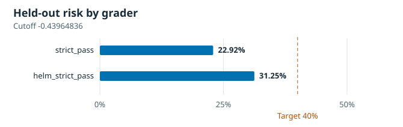

# Confidence-Aware Annotation Toolkit

[](https://github.com/Daveyuwang/caat/actions/workflows/ci.yml)

CAAT is a Python toolkit for deciding which model predictions to accept or send for review. Fit a cutoff on labeled examples, check its error on held-out data, then use the saved policy to route or audit a new batch.


## Try CAAT on five predictions

From an empty directory, install the base CLI (Python 3.10 or later) and download the five-row ticket example.

```bash
python -m pip install caat-annotation
curl --fail --location --create-dirs --output examples/ticket_triage.csv https://raw.githubusercontent.com/Daveyuwang/caat/v1.1.2/examples/ticket_triage.csv
caat evaluate examples/ticket_triage.csv --id-column ticket_id --prediction-column model_route --reference-column expected_route --score-column confidence --group-column inbox --threshold 0.75 --probability --output-dir replay/tickets
```

At a cutoff of 0.75, CAAT accepts three of the five predictions. One of those three is wrong. The output directory contains the risk–coverage curve, Brier score and calibration bins. [Report fields](https://github.com/Daveyuwang/caat/blob/main/docs/guide/reports.md) · [Reliability diagram](https://github.com/Daveyuwang/caat/raw/main/docs/figures/calibration-example.svg)

## Try a review policy

Run the remaining examples from a checkout.

```bash
git clone https://github.com/Daveyuwang/caat.git
cd caat
python -m pip install .
caat policy examples/ifeval_graders.csv --score-column mean_token_logprob --correct-column strict_pass --check-column helm_strict_pass --risk-target 0.4 --plot replay/policy.svg
```

On 217 held-out IFEval responses, the policy accepts 144. Google’s strict grader counts 33 errors among those responses (22.9%). HELM counts 45 (31.2%). Both observed rates fall below the 40% target. [How CAAT selects the cutoff](https://github.com/Daveyuwang/caat/blob/main/docs/research/benchmarks.md#policy-selection)



## Use CAAT on your data

| Task | Guide |
| --- | --- |
| Fit and reuse a policy on CSV or JSONL predictions | [Prediction format](https://github.com/Daveyuwang/caat/blob/main/docs/guide/csv-format.md) and [policy workflow](https://github.com/Daveyuwang/caat/blob/main/docs/guide/workflow.md) |
| Import saved evaluation runs | [Inspect](https://github.com/Daveyuwang/caat/blob/main/docs/guide/inspect.md), [lm-eval](https://github.com/Daveyuwang/caat/blob/main/docs/guide/lm-eval.md), [HELM](https://github.com/Daveyuwang/caat/blob/main/docs/guide/helm.md) and [Every Eval Ever](https://github.com/Daveyuwang/caat/blob/main/docs/guide/every-eval-ever.md) |
| Choose a score or calibrate its probabilities | [Score comparison](https://github.com/Daveyuwang/caat/blob/main/docs/guide/scores.md) and [calibration](https://github.com/Daveyuwang/caat/blob/main/docs/guide/calibration.md) |
| Plan a label budget and resume grading | [Audit handoff](https://github.com/Daveyuwang/caat/blob/main/docs/guide/queue.md#issue-audit-labels-in-blocks) |
| Compare graders or monitor a stream | [CI audit](https://github.com/Daveyuwang/caat/blob/main/docs/guide/ci-audit.md) and [monitoring](https://github.com/Daveyuwang/caat/blob/main/docs/guide/monitor.md) |

On ARC-Challenge, two audit plans reached the same verdict using 200 and 250 labels from the same batch of 1,081 eligible predictions. [Benchmark results](https://github.com/Daveyuwang/caat/blob/main/docs/research/benchmarks.md#batch-audits)

[Method](https://github.com/Daveyuwang/caat/blob/main/docs/research/method.md) · [Contributing](https://github.com/Daveyuwang/caat/blob/main/CONTRIBUTING.md) · [Changelog](https://github.com/Daveyuwang/caat/blob/main/CHANGELOG.md) · [MIT license](https://github.com/Daveyuwang/caat/blob/main/LICENSE)
