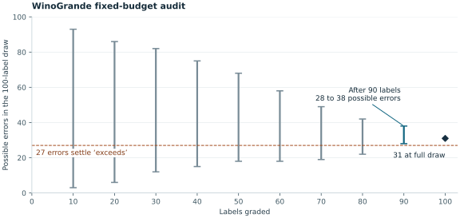

# Confidence-Aware Annotation Toolkit

[](https://github.com/Daveyuwang/caat/actions/workflows/ci.yml)

CAAT helps you decide which classifier or LLM predictions to accept and which to send for review. Give it saved predictions, confidence scores and a labeled sample. It fits a cutoff, reports the error among accepted outputs on held-out data, and applies the saved policy to the next batch.

## Try CAAT on five predictions

From an empty directory, install the base CLI (Python 3.10 or later) and download the five-row ticket example.

```bash
python -m pip install caat-annotation
curl --fail --location --create-dirs --output examples/ticket_triage.csv https://raw.githubusercontent.com/Daveyuwang/caat/v1.1.0/examples/ticket_triage.csv
caat evaluate examples/ticket_triage.csv --id-column ticket_id --prediction-column model_route --reference-column expected_route --score-column confidence --group-column inbox --threshold 0.75 --probability --output-dir replay/tickets
```

At a cutoff of 0.75, CAAT accepts three tickets and makes one error. The output directory contains the risk–coverage curve, Brier score and calibration bins. [Report fields](https://github.com/Daveyuwang/caat/blob/main/docs/guide/reports.md) · [Reliability diagram](https://github.com/Daveyuwang/caat/raw/main/docs/figures/calibration-example.svg)

## Try a review policy

Run the remaining examples from a checkout.

```bash
git clone https://github.com/Daveyuwang/caat.git
cd caat
python -m pip install .
caat policy examples/ifeval_graders.csv --score-column mean_token_logprob --correct-column strict_pass --check-column helm_strict_pass --risk-target 0.4 --plot replay/policy.svg
```

On 217 held-out IFEval responses, the policy accepts 144. Google’s strict grader counts 33 errors among those responses (22.9%). HELM counts 45 (31.2%). Both observed rates fall below the 40% target. [How CAAT selects the cutoff](https://github.com/Daveyuwang/caat/blob/main/docs/research/benchmarks.md#default-selection-rule)


## Bring your own evaluations and scores

Use one row per prediction, with a unique ID and a score that increases with confidence. Supply a 0/1 grade, or name the predicted and reference labels for exact-match grading. CAAT reads CSV and JSONL, and can join scores to saved evaluation runs. [Prediction table format](https://github.com/Daveyuwang/caat/blob/main/docs/guide/csv-format.md) · [Inspect](https://github.com/Daveyuwang/caat/blob/main/docs/guide/inspect.md) · [lm-eval](https://github.com/Daveyuwang/caat/blob/main/docs/guide/lm-eval.md) · [Every Eval Ever](https://github.com/Daveyuwang/caat/blob/main/docs/guide/every-eval-ever.md) · [HELM](https://github.com/Daveyuwang/caat/blob/main/docs/guide/helm.md)

| If you have… | Start here |
| --- | --- |
| A classifier with labeled predictions | [Fit a policy and see review volume by predicted class](https://github.com/Daveyuwang/caat/blob/main/docs/guide/classifier.md) |
| Model-generated labels to review | [Build an annotation queue](https://github.com/Daveyuwang/caat/blob/main/docs/guide/annotation.md) |
| Several candidate confidence scores | [Compare them at the same coverage](https://github.com/Daveyuwang/caat/blob/main/docs/guide/scores.md) |
| Scores to turn into probabilities | [Fit a calibration map and check it on held-out rows](https://github.com/Daveyuwang/caat/blob/main/docs/guide/calibration.md) |

## Reuse one fitted policy from routing through audit

Fit the digits example with the training extra. All four commands below read the resulting workflow file. Routing, evaluation, auditing and monitoring also work in the base install once you have that file.

```bash
python -m pip install ".[scorer,workflow]"
caat run examples/fitted_classifier.toml
caat route examples/fitted_batch.csv --threshold-report replay/fitted-classifier/workflow.json --output replay/decisions.csv
caat evaluate examples/fitted_batch_graded.csv --threshold-report replay/fitted-classifier/workflow.json --correct-column correct
caat audit examples/fitted_batch_graded.csv --threshold-report replay/fitted-classifier/workflow.json --correct-column correct --correct-column second_grade
caat monitor examples/fitted_batch_graded.csv --threshold-report replay/fitted-classifier/workflow.json --correct-column correct
```

The policy accepts `new-a` and sends `new-b` to review. One accepted example gives too little evidence to confirm the 2% target, so evaluate and audit return status 1. The monitor reports no alert. [Workflow configuration](https://github.com/Daveyuwang/caat/blob/main/docs/guide/workflow.md) · [Monitor interpretation](https://github.com/Daveyuwang/caat/blob/main/docs/guide/monitor.md)

## Audit a withheld policy on a new batch

With a hard label ceiling, `caat plan --forecast --budget-ceiling` compares the smallest qualifying cap and the lowest expected grading cost. Choose either offer and issue its saved schedule with `caat audit-block`. On ARC-Challenge, the lower-cost offer reserved 26 more labels and used 50 fewer on the frozen draw. [Compare budgets](https://github.com/Daveyuwang/caat/blob/main/docs/guide/reports.md#plan) · [ARC-Challenge results](https://github.com/Daveyuwang/caat/blob/main/docs/research/arc-challenge-audit.md)

The ANLI policy missed its target on R1. Draw 100 of the outputs its cutoff would accept on R2, then evaluate the saved grades for those exact outputs.

```bash
caat plan --threshold-report results/anli_r2/policy.json --batch-predictions results/anli_r2/predictions.csv --label-budget 100 --sample-seed 42 --sample-output replay/r2-sample.csv --output replay/r2-plan.json
caat evaluate replay/r2-sample.csv --grader-file anli=results/anli_r2/sample-grades.csv --grader-output-key-column output_key --threshold-report results/anli_r2/policy.json --batch-predictions results/anli_r2/predictions.csv --plan-report replay/r2-plan.json
```

The draw found 43 errors in 100 outputs. The one-sided 95% lower bound is 35.34%, above the 20% target. The verdict is `exceeds` (exit 1). Routing stays disabled. [R2 results](https://github.com/Daveyuwang/caat/blob/main/docs/research/fixed-batch-audit.md)

Use `caat audit-block` to issue labels in blocks and `caat evaluate --partial` to see when the full-budget verdict is settled. WinoGrande needed 90 of 100 labels for its frozen draw. The archived BoolQ draw needed all 100. [Labeler handoff](https://github.com/Daveyuwang/caat/blob/main/docs/guide/queue.md#issue-audit-labels-in-blocks) · [Study and replay](https://github.com/Daveyuwang/caat/blob/main/docs/research/winogrande-results.md)



## Pick a confidence score

Extract candidate scores from saved token log probabilities, then compare them with `caat scores`. [Feature definitions](https://github.com/Daveyuwang/caat/blob/main/docs/guide/features.md)

```bash
caat features examples/token_scores.jsonl --output replay/token_scores.csv
```

## Set a cutoff

This empirical example selects `-0.35` and accepts 12 of 24 calibration rows, including four errors. Use the default Learn then Test rule for risk control with a prespecified grid and independent calibration rows. [Selection rules](https://github.com/Daveyuwang/caat/blob/main/docs/guide/reports.md#select)

```bash
caat select examples/ifeval_strict.csv --score-column mean_token_logprob --correct-column strict_pass --thresholds -0.20 -0.35 -0.60 --risk-target 0.4 --rule empirical
```

## Check a grader change

CAAT joins separate grader exports by ID and output identity. Here the graders find one and two errors in the same three accepted tickets. The second grader exceeds the target, so the command exits 1. [Run an audit in CI](https://github.com/Daveyuwang/caat/blob/main/docs/guide/ci-audit.md)

```bash
caat audit examples/audit/predictions.csv --output-key-column output_key --grader-file reference=examples/audit/reference.csv --grader-file rubric=examples/audit/rubric.csv --threshold 0.75 --risk-target 0.4
```

## Benchmarks and development

Run `python scripts/replay_benchmarks.py` to reproduce the bundled IFEval, MMLU-Pro and TriviaQA samples. [Benchmarks and data sources](https://github.com/Daveyuwang/caat/blob/main/docs/research/benchmarks.md) · [Research figures](https://github.com/Daveyuwang/caat/blob/main/docs/figures/README.md) · [Tool comparison](https://github.com/Daveyuwang/caat/blob/main/docs/comparison.md)

[Contributing](https://github.com/Daveyuwang/caat/blob/main/CONTRIBUTING.md) · [Roadmap](https://github.com/Daveyuwang/caat/blob/main/docs/ROADMAP.md) · [Changelog](https://github.com/Daveyuwang/caat/blob/main/CHANGELOG.md) · [MIT license](https://github.com/Daveyuwang/caat/blob/main/LICENSE)
