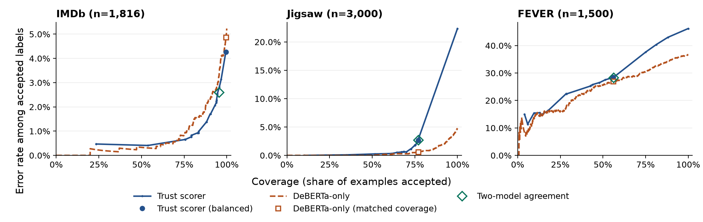

# Course project archive

These sections appeared in the project README. The commands for the original
course replay, training, dashboard, and GPU pilot refer to checkout
`2b63aa800960879549828d0ce27517f2372398aa`. To use that code, create a separate
worktree from a full clone.

```bash
git worktree add --detach ../caat-course 2b63aa800960879549828d0ce27517f2372398aa
```

The saved predictions can also be used from the current checkout. Run
`python scripts/study_modules.py --course` after installing CAAT for the
[matched-coverage replay](../../results/baselines/course.csv). This replay
includes DeBERTa maximum softmax probability on its own labels and the
probability it assigns to the frozen Qwen label. Both use the saved class
probabilities. The course splits support a retrospective comparison. The
Jigsaw sample includes rows from the original training set used by the
DeBERTa pipeline.

### CPU policy comparison

Replay the saved IMDb, Jigsaw, and FEVER predictions from the repo root.
The script compares Qwen labels ranked by the course trust score, Qwen labels
accepted when both models agree, and DeBERTa labels ranked by DeBERTa's own
confidence.

```bash
python -m pip install matplotlib
python scripts/eval_saved_predictions.py --output-dir replay/course
```

The script writes the risk–coverage plot and per-class error table. The
marked DeBERTa point has the highest coverage at or below the balanced trust
scorer's coverage. [Class error table](https://github.com/Daveyuwang/caat/blob/24ca74c32f910b38e18fd6593fc3d6bb5b4f57ab/results/offline_eval/class_errors.csv)



On Jigsaw, the balanced trust scorer and DeBERTa-only each accepted 2,311 of
3,000 examples. DeBERTa made 14 errors and the trust scorer made 62. DeBERTa
accepted 14 gold-toxic examples and misclassified all 14. The trust scorer
accepted 128 and misclassified 29. The course sample spans the original train,
development, and test splits. [Sampling record](https://github.com/Daveyuwang/caat/blob/24ca74c32f910b38e18fd6593fc3d6bb5b4f57ab/results/llm_annotations_7b/jigsaw/jigsaw_sample/jigsaw_20k_sampling_report.json)

#### Jigsaw CLI replay

Run the installed CLI at the course scorer's balanced threshold.

```bash
caat evaluate results/trust_scorer/jigsaw_lr_predictions.csv --id-column example_id --prediction-column llm_label_str --reference-column gold_label_str --score-column trust_score_calibrated --threshold 0.5 --probability --output-dir replay/jigsaw
```

The CLI reports 77.03% coverage and a 2.68% error rate among accepted labels.

### GPU answer-token pilot

The pilot compares three confidence scores on 400 fixed Qwen2.5-7B-Instruct
labels from Jigsaw. The error rates at 75% coverage average over uniform
tie breaks.

| Confidence score | Brier score | Error rate at 75% coverage |
| --- | ---: | ---: |
| A/B answer-token probability | 0.2217 | 19.33% |
| Saved self-reported confidence | 0.1569 | 14.88% |
| Course trust scorer | 0.0380 | 0.56% |

Set up the GPU environment before rerunning inference. [Pinned dependencies](https://github.com/Daveyuwang/caat/blob/24ca74c32f910b38e18fd6593fc3d6bb5b4f57ab/results/answer_token_pilot/README.md#reproduce)

```bash
python scripts/run_answer_token_pilot.py --batch-size 16 --gpu-memory 10GiB --output-dir replay/answer_token_pilot
```

[Pilot record](https://github.com/Daveyuwang/caat/blob/24ca74c32f910b38e18fd6593fc3d6bb5b4f57ab/results/answer_token_pilot/README.md) · [Risk–coverage plot](https://github.com/Daveyuwang/caat/blob/24ca74c32f910b38e18fd6593fc3d6bb5b4f57ab/results/answer_token_pilot/risk_coverage.png) · [Per-example scores](https://github.com/Daveyuwang/caat/blob/24ca74c32f910b38e18fd6593fc3d6bb5b4f57ab/results/answer_token_pilot/scores.csv)

## Course project

The course scorer uses logistic regression with isotonic calibration on Qwen
confidence, DeBERTa predictions, and text features. [Datasets](course-datasets.md) · [Model results and training commands](course-results.md)

The course dashboard shows the saved results for research use. The hosted
dashboard omits example text. [Dashboard](https://one684proj.onrender.com/) · [Local setup](course-results.md#course-dashboard)
