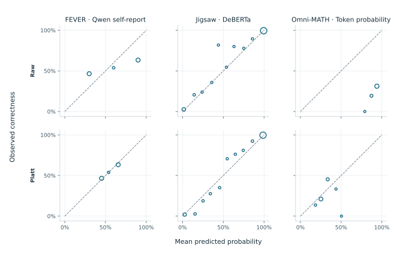

# CPU benchmark replay

The [module study](#module-study) extends this replay to two model
families and compares score features and grader changes on frozen outputs.
The [matched-cost replay](matched-cost.md) compares a score-gated
7B/72B cascade with 72B alone and random routing on WildBench.

The bundled samples contain 24 rows each. Run `python scripts/replay_benchmarks.py`
from an installed checkout to check the evaluator on instruction following,
multiple-choice reasoning, and open-ended factual recall.

| Sample | Score | Cutoff | Accepted | Accepted errors |
| --- | --- | ---: | ---: | ---: |
| [IFEval](../../examples/ifeval_strict.csv) | Mean token log probability | −0.35 | 12 / 24 | 4 |
| [MMLU-Pro](../../examples/mmlu_pro.csv) | Mean token log probability | −0.30 | 12 / 24 | 5 |
| [TriviaQA](../../examples/triviaqa.csv) | Archived response score | 0.50 | 13 / 24 | 0 |

## Full HELM archives

The comparison uses all 541 IFEval and 1,000 MMLU-Pro responses in the
Qwen2.5-7B-Instruct-Turbo HELM Capabilities v1.0.0 runs. The MMLU-Pro archive
is a 1,000-question sample of the official test split. Both evaluations
freeze the model outputs. The script sorts by ID, shuffles with seed 42,
then splits about 20% for threshold design, 40% for calibration, and 40% for
held-out replay. Both IFEval graders use the same split.

```bash
python -m pip install .
python -m pip install -r scripts/requirements.txt
python scripts/prepare_ifeval.py --full
python scripts/prepare_mmlu_pro.py --full
python scripts/study_modules.py --baselines
```

Preparation downloads and caches the pinned public artifacts. Comparison
reuses the prepared CSVs. It writes `ranking.csv`,
`policies.csv`, and `paired_ifeval.csv` under `replay/baselines/`. Omit
`--full` to regenerate the 24-row samples.

[`examples/ifeval_graders.csv`](../../examples/ifeval_graders.csv) carries the
`id`, `mean_token_logprob`, `sequence_logprob`, `strict_pass`, and
`helm_strict_pass` columns of the full Qwen IFEval file,
`replay/ifeval/predictions_full.csv`.
[Policy example](../../README.md#try-a-review-policy) · [Workflow example](../guide/workflow.md)

### Confidence rankings

The two log-probability scores implement the rankings used by LM-Polygraph's
Maximum Sequence Probability and Perplexity estimators using the archived
token log probabilities. Summing the log probabilities preserves the ranking
by sequence probability. Averaging them preserves the ranking by increasing
confidence (decreasing perplexity). Random accepts a uniform subset of the
same size, with expected risk equal to the full-set error rate. Accept-all
is the shared endpoint at 100% coverage.
[LM-Polygraph benchmark](https://aclanthology.org/2025.tacl-1.11/) ·
[Sequence probability](https://lm-polygraph.readthedocs.io/en/v0.4.0/lm_polygraph.estimators.html#lm-polygraph-estimators-max-probability-module) ·
[Perplexity source](https://lm-polygraph.readthedocs.io/en/latest/_modules/lm_polygraph/estimators/perplexity.html)

| Held-out evaluation | Accepted / total | Random | Sequence probability | Perplexity |
| --- | ---: | ---: | ---: | ---: |
| IFEval, Google full pass | 163 / 217 | 25.35% | 25.15% | 24.54% |
| IFEval, HELM full pass | 163 / 217 | 34.56% | 34.97% | 33.13% |
| MMLU-Pro | 300 / 400 | 47.25% | 45.00% | 44.33% |

The table reports accepted error at approximately 75% coverage. The full
table uses the same budget for each score at 25%, 50%, 75%, and 100%,
rounding accepted counts up. Ties at the budget boundary use the expected
error under uniform selection. Each deployed score threshold still accepts
or defers the whole tie group. On MMLU-Pro at 50% coverage, sequence
probability has 39% risk and perplexity has 41%.
The `--baselines` replay writes these values to `ranking.csv`.

### Threshold selection

The design subset fixes up to ten candidate thresholds at the 10% through
100% acceptance quantiles. The empirical rule chooses the most permissive
threshold whose calibration error is at most the target. The Learn then Test
rule uses a one-sided binomial test on accepted calibration examples and
applies Bonferroni correction at family-wise level 0.05 for each benchmark,
score, and risk target. Both rules apply the selected cutoffs unchanged on
the held-out rows. A rule with no eligible threshold accepts zero rows.
[Learn then Test, §3.2](https://arxiv.org/pdf/2110.01052)

Learn then Test found no eligible threshold at either the 20% or the 30%
risk target in this replay. The empirical MMLU-Pro sequence-probability rule
at a 30% target accepted 139 of 400 held-out rows with 47 errors (33.81%).
These are retrospective within-archive splits. Any risk guarantee for
future data depends on the sampling assumptions and grader used.
The `--baselines` replay writes these values to `policies.csv`.

For IFEval, the two full-pass outcomes differ on 40 of 541 instances. The
Google-based empirical rule at the 30% target chose a mean token log
probability cutoff of −0.43964836263206303. Holding the cutoff and the 144
accepted responses fixed gives 33 errors (22.92%) under the Google regrade
and 45 errors (31.25%) under the published HELM grades. The comparison
measures sensitivity to the two grading pipelines. All 40 disagreements
occurred among the 95 prompts with an English capitalization, lowercase,
or language check. The other 446 prompts agreed. This breakdown locates the
disagreement without attributing it to one implementation detail.
The `--baselines` replay writes these values to `paired_ifeval.csv`.

The risk–coverage counts were cross-checked against CalibRoute 0.4.0 at all
1,671 held-out threshold points, using a rank-preserving map for its
`[0, 1]` input range. Direct masks independently checked the matched budgets.
SciPy's binomial CDF and direct acceptance counts reproduced the 24 policy
rows. Recomputed MMLU-Pro grades matched all 1,000 published grades.
[CalibRoute release](https://pypi.org/project/calibroute-ai/0.4.0/)

## Sources and grading

- **IFEval.** Match each archived key, stripped prompt, and instruction
  arguments to Google's dataset at the revision used by HELM. The local
  Google grader at `e6890f8` records a pass when every instruction passes.
  Python and language detection use seed 0. For the published HELM result,
  a response passes when `ifeval_strict_accuracy` is exactly 1, meaning
  full instruction credit. [HELM completions](https://storage.googleapis.com/crfm-helm-public/capabilities/benchmark_output/runs/v1.0.0/ifeval:model=qwen_qwen2.5-7b-instruct-turbo/scenario_state.json) ·
  [HELM grades](https://storage.googleapis.com/crfm-helm-public/capabilities/benchmark_output/runs/v1.0.0/ifeval:model=qwen_qwen2.5-7b-instruct-turbo/per_instance_stats.json) ·
  [Dataset revision](https://huggingface.co/datasets/google/IFEval/tree/966cd89545d6b6acfd7638bc708b98261ca58e84) ·
  [Google grader](https://github.com/google-research/google-research/tree/e6890f85757dd84e27ca6df2dd30651dafad28e0/instruction_following_eval) ·
  [HELM metric source](https://github.com/stanford-crfm/helm/blob/b1bc37e9223645ce91070e4fffd86dd46a04ca75/src/helm/benchmark/metrics/ifeval_metrics.py)
- **MMLU-Pro.** Verify each question, ordered options, and answer key against
  TIGER-Lab's test split at `3373e0b`. Use HELM's chain-of-thought extraction
  patterns to grade the saved choice. An unparsed choice counts as an error.
  [HELM completions](https://storage.googleapis.com/crfm-helm-public/capabilities/benchmark_output/runs/v1.0.0/mmlu_pro:subset=all,use_chain_of_thought=true,use_few_shot=false,model=qwen_qwen2.5-7b-instruct-turbo/scenario_state.json) ·
  [HELM grades](https://storage.googleapis.com/crfm-helm-public/capabilities/benchmark_output/runs/v1.0.0/mmlu_pro:subset=all,use_chain_of_thought=true,use_few_shot=false,model=qwen_qwen2.5-7b-instruct-turbo/per_instance_stats.json) ·
  [Test split](https://huggingface.co/datasets/TIGER-Lab/MMLU-Pro/tree/3373e0b32277875b8db2aa555a333b78a08477ea/data) ·
  [Answer extraction](https://github.com/stanford-crfm/helm/blob/b1bc37e9223645ce91070e4fffd86dd46a04ca75/src/helm/benchmark/metrics/gpqa_chain_of_thought_metric.py)
- **TriviaQA.** Match the first 24 questions from Xia's Llama 8B DPO
  archive to unique questions in the official Web validation split without
  context. Check the archived target against the official aliases and grade
  each response by normalized exact match. The saved `response_prob` is a
  ranking score. Run `python scripts/prepare_triviaqa.py` with PyArrow to
  regenerate the sample. [Saved responses and scores](https://huggingface.co/datasets/yuxixia/triviaqa_llama8b-dpo_test/tree/c73c578fd7302bec3c4ecc69d75691cced11aa4a) ·
  [Validation split](https://huggingface.co/datasets/mandarjoshi/trivia_qa/blob/0f7faf33a3908546c6fd5b73a660e0f8ff173c2f/rc.web.nocontext/validation-00000-of-00001.parquet) ·
  [Official evaluator](https://github.com/mandarjoshi90/triviaqa/blob/51b53595131828a00a1fed09cca9c87f512090e2/evaluation/triviaqa_evaluation.py)

## Module study

The study tests two choices that affect users of the CLI. A fixed acceptance
policy may pass under one grader and fail under another. A task-specific
score may prioritize review better than a generic confidence score, using
the same saved response.

## Replay

The input is the full HELM Capabilities v1.0.0 archive for Qwen2.5-7B-Instruct-Turbo
and Llama 3.1 8B Instruct Turbo on IFEval and MMLU-Pro. The models share the
same 541 IFEval prompts and the same 1,000 MMLU-Pro questions. The preparation
scripts verify prompts, correct choices or instructions, and output IDs.
Each prepared row carries a SHA-256 hash of the saved response text.
[Qwen sources and dataset revisions](#sources-and-grading) ·
[Llama IFEval run](https://storage.googleapis.com/crfm-helm-public/capabilities/benchmark_output/runs/v1.0.0/ifeval:model=meta_llama-3.1-8b-instruct-turbo/scenario_state.json) ·
[Llama IFEval grades](https://storage.googleapis.com/crfm-helm-public/capabilities/benchmark_output/runs/v1.0.0/ifeval:model=meta_llama-3.1-8b-instruct-turbo/per_instance_stats.json) ·
[Llama MMLU-Pro run](https://storage.googleapis.com/crfm-helm-public/capabilities/benchmark_output/runs/v1.0.0/mmlu_pro:subset=all,use_chain_of_thought=true,use_few_shot=false,model=meta_llama-3.1-8b-instruct-turbo/scenario_state.json) ·
[Llama MMLU-Pro grades](https://storage.googleapis.com/crfm-helm-public/capabilities/benchmark_output/runs/v1.0.0/mmlu_pro:subset=all,use_chain_of_thought=true,use_few_shot=false,model=meta_llama-3.1-8b-instruct-turbo/per_instance_stats.json)

```bash
python -m pip install .
python -m pip install -r scripts/requirements.txt
python scripts/prepare_ifeval.py --full
python scripts/prepare_ifeval.py --model llama --full
python scripts/prepare_mmlu_pro.py --full
python scripts/prepare_mmlu_pro.py --model llama --full
python scripts/study_modules.py
```

The run writes the aggregate tables and aligned held-out CSVs to
`replay/module_study/`. For example, reproduce the 30% Qwen IFEval audit
with the cutoff recorded in `policies.csv`.

```bash
caat audit replay/module_study/ifeval_qwen_heldout.csv --score-column mean_token_logprob --correct-column strict_pass --correct-column helm_strict_pass --threshold -0.43964836263206303 --risk-target 0.30
```

## Fitted cutoffs versus CalibRoute

CAAT 0.3.0rc1 and CalibRoute 0.4.0 fit their own cutoffs on five HELM
archives. Each tool receives the same `exp(mean_token_logprob)` score,
calibration rows, primary grade, and risk target. IFEval and MMLU-Pro use
the seed-42 split above. Omni-MATH uses the saved chronological split
of 200 design, 400 calibration, and 400 holdout rows.
[Omni-MATH partitions](../guide/monitor.md#chronological-omni-math-replay)

CAAT uses design-score deciles with either Bonferroni or Holm correction
at a 5% family-wise failure rate. CalibRoute searches among calibration
scores with a pointwise 95% Clopper–Pearson upper bound. After fitting,
each cutoff stays fixed. The table gives automatic acceptance at the
cutoff and the observed error among accepted answers, with the one-sided
95% exact upper bound in parentheses. Acceptance is measured before batch
routing. A missing cutoff gives zero acceptance and undefined error.

| Archive | Target | Fit rule | Accepted | Primary error (upper bound) | Alternate error (upper bound) |
| --- | ---: | --- | ---: | ---: | ---: |
| IFEval Qwen | 40% | CAAT Bonferroni | 144/217 (66.36%) | 22.92% (29.42%) | 31.25% (38.20%) |
| IFEval Qwen | 40% | CAAT Holm | 189/217 (87.10%) | 26.46% (32.25%) | 34.92% (41.04%) |
| IFEval Qwen | 40% | CalibRoute | 213/217 (98.16%) | 25.82% (31.22%) | 34.74% (40.48%) |
| IFEval Llama | 40% | CAAT Bonferroni | 215/217 (99.08%) | 22.79% (28.00%) | 34.42% (40.12%) |
| IFEval Llama | 40% | CAAT Holm | 215/217 (99.08%) | 22.79% (28.00%) | 34.42% (40.12%) |
| IFEval Llama | 40% | CalibRoute | 216/217 (99.54%) | 22.69% (27.87%) | 34.26% (39.94%) |
| MMLU-Pro Qwen | 40% | CAAT Bonferroni | 0/400 (0.00%) | n/a | n/a |
| MMLU-Pro Qwen | 40% | CAAT Holm | 0/400 (0.00%) | n/a | n/a |
| MMLU-Pro Qwen | 40% | CalibRoute | 145/400 (36.25%) | 37.93% (45.05%) | 35.86% (42.93%) |
| MMLU-Pro Llama | 40% | CAAT Bonferroni | 0/400 (0.00%) | n/a | n/a |
| MMLU-Pro Llama | 40% | CAAT Holm | 0/400 (0.00%) | n/a | n/a |
| MMLU-Pro Llama | 40% | CalibRoute | 0/400 (0.00%) | n/a | n/a |
| Omni-MATH Qwen | 80% | CAAT Bonferroni | 398/400 (99.50%) | 69.85% (73.64%) | 69.85% (73.64%) |
| Omni-MATH Qwen | 80% | CAAT Holm | 398/400 (99.50%) | 69.85% (73.64%) | 69.85% (73.64%) |
| Omni-MATH Qwen | 80% | CalibRoute | 398/400 (99.50%) | 69.85% (73.64%) | 69.85% (73.64%) |

On IFEval Qwen, both grader bounds fell below 40% at the CAAT Bonferroni
cutoff. On IFEval Llama, both fell below 40% at the CalibRoute cutoff.
CalibRoute's MMLU-Pro Qwen cutoff missed the target on both holdout
grades. At the 80% Omni-MATH target, all three rules accepted the same
398 answers. The complete table includes cutoff values and pass flags.
[Results](../../results/decision_baselines/comparison.csv) · [Protocol and hashes](../../results/decision_baselines/protocol.json)

Prepare the four IFEval and MMLU-Pro CSVs with the commands in
[Replay](#replay). For `HELM_OMNI_MATH_RUN`, use the directory containing
`scenario_state.json` and `per_instance_stats.json` from the Qwen
Omni-MATH v1.0.0 run. The replay uses Google strict and HELM full pass
for IFEval, HELM and TIGER-Lab parsing for MMLU-Pro, and the archived
GPT and Llama verdicts for Omni-MATH.
[Archive provenance](judge-study.md#archived-inputs)

```bash
python -m pip install calibroute-ai==0.4.0
caat helm HELM_OMNI_MATH_RUN --metric omni_math_accuracy --annotation omni_math.gpt_equivalence_judgement --annotation omni_math.llama_equivalence_judgement --output replay/helm-import/omni.csv
python scripts/study_decision_baselines.py
```

The [replay script](../../scripts/study_decision_baselines.py) uses
`caat select` and one `caat audit` call per fitted CAAT cutoff. It uses
`calibroute fit` and one `calibroute validate` call per grader and fitted
CalibRoute cutoff. CAAT's audit verifies that holdout outputs were absent
from fitting. The replay checks both tools against direct acceptance
counts and binomial calculations and saves the command reports under
`replay/decision-baselines/`.

### Candidate grid and multiple-testing correction

The diagnostic applies CalibRoute's exported 95% Clopper–Pearson bound
at the same design-score deciles as CAAT's Learn then Test rules. It
selects the lowest cutoff whose bound meets the target and accepts at
least one calibration row. The next step uses CalibRoute's native fit
over the distinct calibration scores with that same pointwise test.
Each selected cutoff is frozen for the original paired holdout.
[CalibRoute 0.4.0](https://pypi.org/project/calibroute-ai/0.4.0/)

| Archive | Accepted with pointwise design cutoffs | Change from Bonferroni | Change from Holm | Change from switching to calibration cutoffs |
| --- | ---: | ---: | ---: | ---: |
| IFEval Qwen | 211/217 | +67 | +22 | +2 |
| IFEval Llama | 215/217 | 0 | 0 | +1 |
| MMLU-Pro Qwen | 88/400 | +88 | +88 | +57 |
| MMLU-Pro Llama | 0/400 | 0 | 0 | 0 |
| Omni-MATH Qwen | 398/400 | 0 | 0 | 0 |

The changes count accepted holdout rows. The two correction columns
keep the design grid fixed. The last column changes the grid with the
pointwise test fixed. On IFEval Qwen, the shared-grid pointwise cutoff
had a 40.36% upper bound under the alternate grader at the 40% target.
On MMLU-Pro Qwen, its primary-grader error was 28/88 (31.82%) with a
40.93% upper bound at the same target.
[Cutoffs and holdout counts](../../results/decision_baselines/cutoff_grid_comparison.csv) · [Protocol](../../results/decision_baselines/cutoff_grid_protocol.json)

After preparing the same archives and installing CalibRoute 0.4.0, run
the diagnostic to write the two CSVs and protocol to `replay/cutoff-grid/`.

```bash
python scripts/study_cutoff_grid.py
```

[Replay script](../../scripts/study_cutoff_grid.py)

### Design quantile count

The replay fixes the splits and risk targets and tests 10, 20, and 50
design-score quantiles with each correction. Each setting applies the
5% family-wise error rate to its distinct candidates, then checks its
frozen cutoff on the paired holdout.
[Learn then Test](https://arxiv.org/abs/2110.01052)

On MMLU-Pro Qwen, 20 quantiles qualified the same cutoff under
Bonferroni and Holm. It accepted 74 of 400, with 19 errors under the HELM
grader and 17 under TIGER-Lab. The 95% upper bounds were 35.36% and
32.44% at a 40% target. The 10- and 50-quantile fits found no eligible
cutoff for either correction. On IFEval Qwen, Bonferroni accepted 144,
120, and 118 of 217 as the grid grew. Both graders' upper bounds stayed
below the 40% target in those three fits. The full table includes each cutoff and
held-out check.
[Results](../../results/decision_baselines/grid_density_comparison.csv) · [Protocol](../../results/decision_baselines/grid_density_protocol.json)

Set `--design-grid-size` on `caat select --design` and `caat policy`, or
`design_grid_size` in the TOML workflow. Choose the setting before
calibration and evaluate the frozen cutoff on an independent holdout.
Run the comparison from the environment used for the candidate-grid
diagnostic.

```bash
python scripts/study_grid_density.py
```

[Replay script](../../scripts/study_grid_density.py) · [TOML settings](../guide/workflow.md#run-on-your-own-data)

### Fitting with several graders

The six-archive replay uses the five HELM splits and the original Inspect
TriviaQA split. Each setting keeps the score, design grid, and calibration
rows fixed. It fits three policies with Bonferroni or Holm at 5% using
10 or 20 design quantiles. One uses the primary labels, one applies the
target to each grader, and one counts a row as an error if either grader
marks it wrong. Each cutoff stays fixed for the paired holdout audit.
[Risk definitions](method.md#calibrate-for-several-graders)

For IFEval Qwen with Holm and ten quantiles, using both graders for
calibration reduced held-out acceptance from 189 to 92 of 217. The
alternate grader's one-sided 95% upper bound went from 41.04% to 33.52%,
below the 40% target. The fitted policy used 216 additional calibration
labels from the alternate grader. On Inspect, the primary fit accepted
101 of 400, with an upper bound of 46.25% under canonical grading. Both
rules and both grids produced zero eligible cutoffs when each grader
had to meet the target. The lowest p-value with 20 quantiles was 0.1584,
above the unadjusted 0.05 level. That candidate accepted 22 calibration
answers with 6 canonical errors.

On MMLU-Pro Qwen with 20 quantiles, all three fits accepted 74 of 400
with both grader bounds below 40%. On Omni-MATH at 80%, they accepted
398 of 400. Its bound was 73.64% for each grader and 74.12% for an
error under either grader. The two fits that used both graders chose
the same cutoffs in all 24 settings. At the tested targets and grids,
requiring the alternate grader yielded 8 settings with a cutoff and both
holdout bounds below target. The primary-only fit yielded 18 cutoffs,
9 of which met both holdout targets.
[All 72 fits](../../results/decision_baselines/paired_calibration_comparison.csv) · [Protocol and hashes](../../results/decision_baselines/paired_calibration_protocol.json)

The replay uses the prepared HELM archives from the fitted cutoff
comparison above. Pass the original Inspect partitions to include the
sixth archive. It runs `caat select` and `caat audit` and independently
recomputes the qualification decisions and holdout bounds.

```bash
python scripts/study_paired_calibration.py --inspect-splits replay/inspect-pilot/risk-40
```

[Replay script](../../scripts/study_paired_calibration.py)

### Choosing a score for a risk target

The replay compares three choices on the same design, calibration, and
holdout rows. The workflow baseline picks normalized AURC gain on design
rows. The target-coverage choice uses the largest design acceptance count
whose observed error meets the risk target, breaking ties with AURC gain.
Each design choice tests the chosen score's cutoffs on calibration rows.
The joint choice tests all prespecified score-cutoff pairs in one
Bonferroni family and picks the qualifying pair with the largest
calibration acceptance count. For equal counts it takes the smaller
p-value, then the first candidate in the configured order. Every score
uses ten design quantiles with ties deduplicated. The calibration failure
rate is 5% in each setting.
[Learn then Test, Theorem 1](https://arxiv.org/abs/2110.01052)

| Cohort | Target | Design AURC | Design coverage at target | Joint calibration |
| --- | ---: | ---: | ---: | ---: |
| IFEval Qwen | 40% | 55/217 | 55/217 | 108/217 |
| TriviaQA Qwen2.5-7B | 40% | 191/400 | 165/400 | 159/400 |
| TriviaQA Phi-4-mini | 40% | 111/400 | 111/400 | 124/400 |
| MMLU-Pro Qwen2.5-7B | 80% | 393/400 | 393/400 | 399/400 |

The table shows the settings where the methods differed in confirmed
acceptance. The holdout check uses a one-sided 95% upper bound for each
grader at the frozen cutoff. All three methods cleared the holdout target
in the same 5 of 18 settings. On IFEval Qwen, the joint fit selected mean
token log probability. The Google and HELM upper bounds for its 108
accepted answers were 27.79% and 33.78%. On TriviaQA Qwen2.5-7B, the joint
fit selected summed token log probability at a stricter cutoff. That fit
used a family of 71 candidates across all scores. The design AURC fit
used ten cutoffs for its chosen score.
[All results](../../results/decision_baselines/score_choice_comparison.csv) · [Protocol and hashes](../../results/decision_baselines/score_choice_protocol.json)

Use the prepared IFEval archives and frozen three-family score tables.
For Inspect, give the original split files and the joined P(True) and
negative output-token-count scores. The replay checks Inspect IDs,
completion keys, original scores, and grades before using the joined
table. The family comparison uses the shared rows and excludes the random
control and optional estimators. The script verifies calibration decisions
against direct binomial calculations.
[Model-family data](model-families.md) · [Joining Inspect scores](../guide/inspect.md)

```bash
python scripts/study_score_choice.py --inspect-splits replay/inspect-pilot/risk-40 --inspect-scores replay/inspect-pilot/multiple-scores/installed/joined.csv
```

[Replay script](../../scripts/study_score_choice.py)

### Shared cutoffs with MAPIE

The same five cohorts also compare CAAT with MAPIE's binary precision
controller. Both use the design-score deciles, the same calibration
labels, and a 5% family-wise error rate. MAPIE controls precision at
one minus the error target and minimizes abstention among the qualified
cutoffs. The held-out error rates and exact upper bounds use the common
replay calculation for both tools.
[MAPIE risk controller](https://mapie.readthedocs.io/en/stable/api/risk-control/)

MAPIE 1.4.1 and 1.6.0 match CAAT on all 100 candidate qualification
decisions under Bonferroni and Holm. They select the same cutoff in six
settings. The four MMLU-Pro settings produce no cutoff. The frozen
cutoffs give the same holdout coverage and error under both graders.
[Comparison](../../results/decision_baselines/mapie_comparison.csv) · [Candidate results](../../results/decision_baselines/mapie_candidates.csv)

MAPIE's multiple-testing functions also reproduce CAAT's qualification
decisions when given SciPy's exact binomial tails from integer counts.
In the native precision controller, the conversion from precision to an
error count rounds up by one on 8 of the 50 distinct candidates. Seven
p-values differ by more than `1e-12`. Each candidate keeps the same
qualification decision on this replay.
[MAPIE 1.4.1 p-value calculation](https://github.com/scikit-learn-contrib/MAPIE/blob/v1.4.1/mapie/risk_control/methods.py#L428) · [MAPIE 1.6.0 p-value calculation](https://github.com/scikit-learn-contrib/MAPIE/blob/v1.6.0/mapie/risk_control/methods.py#L291)

After preparing the same five archives, install the research requirements
and run the comparison. This writes the selected cutoffs, per-candidate
p-values, and a protocol with the package versions and split hashes.

```bash
python -m pip install -r scripts/requirements.txt
python scripts/study_mapie.py
```

[Replay script](../../scripts/study_mapie.py) · [MAPIE 1.4.1 protocol](../../results/decision_baselines/mapie_protocol.json) · [MAPIE 1.6.0 protocol](../../results/decision_baselines/mapie_1.6_protocol.json)

### Default selection rule

This replay asks which rule `caat policy` should use when the user names
none. It repeats the 20/40/40 split with 200 seeds on six saved archives at
two risk targets each, and applies all four rules to every split. A split
with no selected cutoff counts as zero coverage.

| Rule | Splits with a cutoff | Mean held-out coverage | Held-out error above target | Worst setting |
| --- | ---: | ---: | ---: | ---: |
| `empirical` | 99.5% | 67.3% | 22.6% | 45.0% |
| `ltt-bonferroni` (default) | 78.7% | 41.0% | 0.8% | 3.0% |
| `ltt-holm` | 78.7% | 41.6% | 1.0% | 4.0% |
| `ltt-fixed-sequence` | 75.5% | 41.9% | 2.5% | 7.5% |

The empirical rule accepts more, and its accepted error on the held-out
rows exceeded the target in 22.6% of splits, up to 45.0% for IFEval at a
25% target. Bonferroni and Holm stayed below their 5% failure rate in
every setting. Fixed sequence averaged 2.5% and reached 7.5% on FEVER at a
30% target. Holm selects a cutoff in the same splits as Bonferroni and
adds 0.6 points of coverage. Fixed sequence stops at the first candidate
that fails. It selects less often on IFEval and IMDb, where the strictest
cutoffs accept few rows, and more often on FEVER.

`ltt-bonferroni` stays the default. It is the most conservative of the
three, the gain from Holm is small, and both give the same guarantee. Use
`--rule ltt-holm` for the extra coverage and `--rule empirical` only for
exploration.

The archives are the 541 Qwen IFEval rows, the 1,000-question Qwen TriviaQA
and MMLU-Pro runs, and the IMDb, Jigsaw, and FEVER course predictions. The
splits of one archive share rows, so the shares describe these archives
and are not independent trials. An observed held-out rate above the target
is also a noisy sign of a true rate above it when few rows are accepted.

```bash
python scripts/study_default_rule.py
```

The script reads only files in the repository and runs in under a minute.
[Results by setting](../../results/decision_baselines/default_rule.csv) · [Replay script](../../scripts/study_default_rule.py) · [Terms](../guide/glossary.md#selection-rules)

## Design score screen

Run `python scripts/study_features.py` after preparing the four complete
archives. For each archive, the script uses the original seed-42 design
split and its primary grader. It compares each score with mean token log
probability at 75% coverage. The matched-budget calculation averages over
ties at the boundary. A candidate enters the default registry if it lowers
risk in at least three of the four archives.

| Candidate | Direction for higher confidence | Design archives with lower risk |
| --- | --- | ---: |
| Minimum token log probability | Higher minimum | 1 / 4 |
| Token log probability population standard deviation | Less variation | 0 / 4 |
| Share of tokens with probability below 0.1 | Lower share | 1 / 4 |
| Mean log probability of the final tenth of tokens | Higher mean | 1 / 4 |
| Distinct adjacent word-pair ratio | Higher ratio | 0 / 4 |

The five candidate scores remain in the research script. The output at
`replay/feature_screen.csv` records each observed risk difference.

## Grader changes

IFEval compares Google's pinned strict grader with the published HELM
full-pass outcome. MMLU-Pro compares HELM answer extraction with the
TIGER-Lab local evaluator's extraction rules at commit `26d41d0`. For both
extractors an unparsed output counts as incorrect. The local evaluator's
separate random-guessing step would change the outcome without a change to
the response, so the paired comparison uses its extraction rules alone.
The recomputed HELM outcomes agree with all 2,000 published MMLU-Pro grades.
[TIGER-Lab answer extraction](https://github.com/TIGER-AI-Lab/MMLU-Pro/blob/26d41d02c9f6e1794e74a2740ed378cb0562faea/evaluate_from_local.py#L102-L125)

The archives show 40 and 57 grader disagreements on Qwen and Llama IFEval,
respectively. All 97 involve language or English letter-case checks.
MMLU-Pro has 8 disagreements on Qwen and 30 on Llama. The counts reflect
the behavior of these graders and the specified extraction rules.
[All and held-out disagreement counts](../../results/module_study/disagreements.csv)

For each archive, order IDs, shuffle with seed 42, and split about
20%/40%/40% into design, calibration, and held-out sets. The two model
archives for a task share the same question IDs per split. Fix the score to
mean token log probability. Choose up to ten cutoffs from design quantiles.
Evaluate at 20%, 30%, and 40% target risk, using empirical selection or
Bonferroni Learn then Test at 0.05 per archive and target. For two graders,
empirical selection requires both accepted error rates to meet the target.
Learn then Test uses the higher accepted error count in the one-sided
binomial test. Each policy applies its selected cutoff unchanged on the
held-out set. A missing cutoff corresponds to zero automatic acceptance.
[Learn then Test](https://arxiv.org/pdf/2110.01052)

| Archive | Accepted, primary empirical rule at 30% | Primary grader risk | Alternate grader risk |
| --- | ---: | ---: | ---: |
| IFEval, Qwen | 144 / 217 | 22.92% | 31.25% |
| IFEval, Llama | 18 / 217 | 27.78% | 44.44% |
| MMLU-Pro, Qwen | 88 / 400 | 31.82% | 28.41% |
| MMLU-Pro, Llama | 0 / 400 | Undefined | Undefined |

For Qwen IFEval, requiring both graders under the empirical 30% rule
reduced acceptance from 144 to 92. Held-out risk was 20.65% and 25.00%
under the two graders. At a 40% target, Learn then Test on both graders
also accepted 92, down from 144 for the primary grader alone. For Llama
IFEval at 40%, Learn then Test accepted 215 with the primary grader and
found no eligible threshold with both. These are coverage costs at the
available calibration sample sizes and candidate cutoffs. The empirical
two-grader rule can still exceed the target on held-out data, as it did
for Qwen MMLU-Pro at 30%.
[Policy table and paired intervals](../../results/module_study/policies.csv)

Independent masks reproduced all 48 policy rows. CalibRoute 0.4.0
reproduced the risk and coverage for every selected cutoff with nonzero
coverage. The installed `caat audit` CLI also reproduced the paired
counts on all four held-out archives from separate, reordered grader
exports.
[CalibRoute release](https://pypi.org/project/calibroute-ai/0.4.0/)

## Confidence scores

The comparison reuses the saved generation for every score. Raw features
include mean and sum of token log probabilities, mean of the lowest tenth
of token log probabilities, and the negative log of token count. The
fusion model fits an L2-regularized logistic regression on standardized
mean log probability, low-token log probability, and log token count
using design rows and the primary grader. A fitted mean-only logistic
model and the design-set base rate provide probability baselines.

For MMLU-Pro the answer-token score uses the archived log probability
of the token containing the explicitly marked option. Token text must
reconstruct the saved response up to the end of that response. Missing
or unaligned spans rank last. The presence-only control assigns a binary
score to whether the span is available. We also fit two fusion models
adding presence alone and presence plus the log probability. These
comparisons use zero additional model calls and generated tokens.

| Archive, graded by HELM | Mean token log probability | Answer present | Answer-token log probability | Fusion with answer token |
| --- | ---: | ---: | ---: | ---: |
| MMLU-Pro, Qwen | 44.33% | 45.29% | 41.33% | 42.00% |
| MMLU-Pro, Llama | 53.33% | 50.15% | 46.67% | 46.00% |

The table reports error among 300 accepted responses per model. Answer
token scoring improved on presence alone by 3.95 and 3.48 percentage
points. The paired 95% bootstrap intervals for the change were
−6.03 to −1.08 and −4.99 to −1.26 percentage points, respectively.
Against mean token log probability, the reduction was clearer for Llama
(−6.67 points, interval −10.00 to −3.11) than for Qwen (−3.00 points,
interval −6.47 to 1.33). The ranking intervals resample held-out
questions and recompute the matched budget for both scores. Policy
intervals resample the accepted set at the frozen threshold. Both use 2,000
paired bootstrap replicates, seed 20261115, and percentile intervals.
The intervals are per comparison from a retrospective study.

The generic three-feature fusion gave mixed results on IFEval, and the
plain sequence score was stronger than that fusion for Llama IFEval at
75% coverage. Missing answer spans also differed by model (51/1,000
Qwen and 181/1,000 Llama). Keep the score configurable. Use the
answer-token score when a multiple-choice pipeline records aligned token
probabilities, and evaluate its presence rate as part of onboarding.
[Risk–coverage and Brier tables](../../results/module_study/ranking.csv) ·
[Paired score differences](../../results/module_study/ranking_deltas.csv)
## Correctness calibration

The replay compares temperature, Platt, isotonic, and histogram maps with
the original probability on five archives. IMDb, Jigsaw, and FEVER have
two scores for the Qwen label: Qwen's verbalized probability and DeBERTa's
probability of that label. WildBench and Omni-MATH use archived HELM
Qwen2.5-7B-Instruct-Turbo responses, with GPT scores of at least 7 and GPT
answer equivalence as their respective outcomes. For these two archives,
the geometric mean of response-token probabilities is treated as a
candidate correctness probability for the comparison.

The replay sorts stable IDs and splits with seed 42 using the same 20/40/40
procedure as `caat policy`. It fits each map on the middle 40% and computes
Brier, ECE, ACE, and AUROC on the final 40%. Each method is reported
alongside the original scores.

Seven of the eight archive–score pairs lower held-out Brier under at least
one map. On Jigsaw with DeBERTa, the raw Brier score is 0.0309 and the raw
ECE is 0.0114. All four maps increase both errors on this split.
[All held-out metrics](../../results/calibration/summary.csv) ·
[Reliability bins](../../results/calibration/reliability.csv)



Marker size increases with bin count. The figure shows one fixed method,
Platt scaling, and the raw score on three distinct tasks. The full table
includes all four fitted methods.

With the prepared HELM archives already cached, replay the study and
rebuild the figure using the pinned research environment. The figure step
reads the saved table and runs offline.

```bash
python scripts/study_calibration.py
python scripts/verify_toolkit.py
python scripts/figures.py --calibration-only
```

The reference check compares isotonic and Platt predictions with
scikit-learn, temperature loss with SciPy, Brier with scikit-learn,
and ECE, ACE, and fixed-width histogram calculations with NumPy and SciPy.

## Review queues

The course replay orders saved Qwen labels by increasing DeBERTa
probability of the Qwen label. The queue takes the bottom quarter of each
archive and checks those rows against the gold labels.

| Archive | Rows reviewed | Errors in confidence queue | Errors in random queue (seed 42) | Expected random errors |
| --- | ---: | ---: | ---: | ---: |
| IMDb | 454 | 68 | 23 | 19.5 |
| Jigsaw | 750 | 633 | 157 | 167.75 |
| FEVER | 375 | 289 | 189 | 173.25 |

`python scripts/study_queue.py` regenerates the table from the saved
course predictions. [Replay table](../../results/course/queue.csv) ·
[Queue guide](../guide/queue.md)

## Local Qwen confidence benchmark

Compare token-probability baselines, verbalized confidence, P(True),
sample agreement, and discrete semantic entropy on the same Qwen2.5-7B
answers. The replay covers TriviaQA short answers and MMLU-Pro multiple
choice, with recorded call counts and wall times on an RTX 5080.
[Benchmark and reproduction](black-box-benchmark.md)
