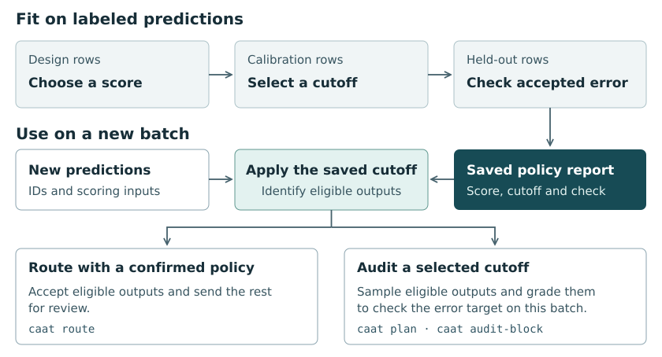

# How CAAT builds and uses a review policy

A review policy specifies which predictions to accept and how much error is tolerable among them. CAAT selects the policy on labeled data and checks it on a separate holdout.

*Confirmation enables routing. A withheld policy with a selected cutoff can still supply a sample for a batch audit.*

## Module design

| Stage | Input | Result |
| --- | --- | --- |
| Score | A model score, saved token probabilities or fitted features | One score per prediction, oriented so higher means more confident. |
| Select | Labeled design and calibration rows | The design split chooses a score and candidate cutoffs. Calibration selects the lowest qualifying cutoff for the risk target. |
| Check | Held-out predictions and grades | Coverage and accepted error for each grader. A policy is confirmed when every required grader passes. |
| Use | Saved policy and new predictions | Route eligible predictions under a confirmed policy, or draw an audit sample under any selected cutoff. |

Probability calibration is optional. It maps a score to the probability that a specified grader will mark the prediction correct. Routing needs only the score and cutoff. [Calibration guide](../guide/calibration.md)

## Definition

At cutoff *t*, count every prediction with a score at or above *t*. Ties enter together. For a given grader:

| Measure | Calculation |
| --- | --- |
| Coverage | Accepted predictions / all predictions |
| Accepted error | Errors among accepted predictions / accepted predictions |

Accepted error is undefined at zero coverage. [Selective classification](https://arxiv.org/abs/1705.08500)

## Calibrate for several graders

At a candidate cutoff, let *n* be the number of accepted calibration rows and *e*g the errors marked by grader *g*. For independent calibration rows from the target population, use a binomial error count *X* with *n* trials and error probability equal to the risk limit *r*. Each grader’s one-sided p-value is Pr(*X* ≤ *e*g).

Use the largest grader p-value for that cutoff. Passing this test requires every grader to pass, even when their grades are correlated. The Learn then Test correction accounts for the candidate cutoffs fixed before calibration. [Berger and Hsu, Theorem 1](https://doi.org/10.1214/ss/1032280304) · [Learn then Test](https://arxiv.org/abs/2110.01052)

## Audit a new batch

The eligible population contains all predictions scoring at or above the saved cutoff. CAAT draws uniformly without replacement. Finite-population bounds determine whether the error rate of that population meets or exceeds the target, or whether the sample is inconclusive.

For a planned two-stage audit, the first checkpoint can settle the verdict before the full budget is spent. The final verdict applies to this batch. [Label budgets and handoff](../guide/queue.md) · [ARC-Challenge comparison](arc-challenge-audit.md)
